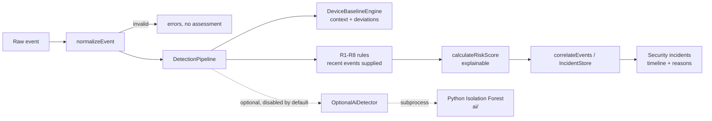

# CloudGuard IoT — M4 Implementation Guide

**Status:** Completed M4 subsystem (detection, risk, correlation, simulation) plus an
independent, optional ML anomaly detector. Synthetic ML results are **not** evidence of
production performance.

**Branch:** `feature/m4-completion` · **Safety checkpoint:** local tag
`m4-safety-checkpoint-20261121` at `0b1a944`.

---

## 1. Architecture



Layers:

| Layer | File | Ownership | Notes |
| --- | --- | --- | --- |
| Types | `src/lib/risk/types.ts` | existing M4 | Unchanged |
| Normalizer | `src/lib/risk/event-normalizer.ts` | existing M4 | Unchanged, reused |
| Rules | `src/lib/risk/rules.ts`, `rule-implementations.ts` | existing M4 | Unchanged, reused |
| Risk | `src/lib/risk/score.ts` | existing M4 | Unchanged, reused |
| Baseline | `src/lib/risk/baseline.ts` | new M4 | Pure statistics |
| Pipeline | `src/lib/risk/pipeline.ts` | new M4 | Orchestration service |
| Correlation | `src/lib/risk/correlation.ts` | new M4 | Incidents and lifecycle |
| ML features | `src/lib/risk/ml-features.ts` | new M4 | Mirrors Python schema |
| AI interface | `src/lib/risk/ai-integration.ts` | new M4 | Optional, fails open |
| Simulator | `src/lib/risk/simulator.ts` | new M4 | Offline, deterministic |
| ML module | `ai/` | new M4 | Independent Python package |

Other top-level directories (`01-System-Analysis`, `UI_UX`, `API-and-Testing`, etc.)
belong to other workstreams and were not modified. No root `package.json`, API endpoint,
or Next.js project was added: tests use the existing Node test runner and TypeScript
type stripping (Node 24+).

---

## 2. Device baseline methodology

`DeviceBaselineEngine` keeps one independent state per device (`sourceId`). Each
observation stores, per feature: sample count, running mean, population standard
deviation (Welford), min and max. Raw observations are **not retained**.

| Feature | Derivation from normalized events |
| --- | --- |
| `mqttMessagesPerMinute` | `MQTT_MESSAGE_RECEIVED` count / window minutes |
| `averagePayloadSizeBytes` | Mean of valid `metadata.payloadSizeBytes` |
| `connectionAttemptsPerMinute` | `CONNECTION_ATTEMPT` count / window minutes |
| `failedAuthenticationAttempts` | Count with `authenticationResult === "failed"` |
| `uniqueTopicsAccessed` | Distinct non-empty `metadata.topic` values |

Key rules:

- Status is `uninitialized` (0 samples), `learning` (1…minSamples-1) or
  `established` (>= `minSamples`, default 20). Missing observations produce no
  invented values — all summary statistics are `null`.
- Invalid (non-finite, negative, non-numeric) values and values above
  `maxFeatureValue` (default 100,000) are rejected and counted.
- Observations marked `confirmedMalicious` by the pipeline (events that produced
  any R1–R8 finding) never update the baseline.
- Once established, per-feature values are clipped to `mean ± outlierSigma·σ`
  (default 3σ) before updating, so one burst cannot poison the baseline.
- `describeDeviations()` returns human-readable z-score explanations, but only
  for established baselines. Deviations are **context**, not new detections.
- Baselines can be updated, retrieved (`get`), and serialized as rule context
  (`getContext`). The engine has no dependency on rules or ML.

---

## 3. Detection and risk pipeline

`DetectionPipeline.assess(rawEvent, options?)` returns a deterministic
`SecurityAssessment`:

```text
Incoming Event
→ normalizeEvent (existing)
→ assign deterministic eventId (evt-<device>-<sequence>)
→ baseline observation + deviation explanation (pre-update baseline)
→ R1–R8 with recentEvents and baseline context (existing rules)
→ risk score with event-time finding timestamps
→ optional AI assessment (disabled by default)
→ SecurityAssessment
```

- `recentEvents` may be supplied explicitly or are taken from per-device in-memory
  history (bounded, default 500 events); this is what count-based rules R1/R2/R5 need.
- Invalid events return `success: false` with all normalization errors; they are
  never scored or learned from.
- Findings are copied with `detectedAt = event.occurredAt` before scoring. Rules
  stamp wall-clock time; the copy makes replayed historical scenarios deterministic
  without changing rule logic.
- Risk scoring is the unchanged existing implementation:

  `contribution = severityWeight × 0.5^(ageMinutes / 30)`, weights
  low=10, medium=20, high=35, critical=50; duplicates (`ruleId:eventId`) removed;
  total capped at 100; levels low<25, medium<50, high<75, critical>=75.
  A single medium finding yields 20 points ("low" level) and a single high finding
  yields 35 points ("medium" level) under this unchanged formula.
- `assess()` is `async` only to accommodate optional AI inference. With AI disabled,
  all rule and risk results are synchronous in effect.

### R1–R8 (unchanged)

| ID | Rule | Trigger (summary) | Finding severity |
| --- | --- | --- | --- |
| R1 | Excessive MQTT Messages | >100 messages / 60 s per client | medium |
| R2 | Repeated Failed Authentication | >=5 failures / 5 min per client | medium |
| R3 | Unauthorized Command | `authorizationResult === "denied"` | high |
| R4 | Abnormal Payload Size | trusted `payloadSizeBytes > 4096` | high |
| R5 | Abnormal Connection Frequency | >10 attempts / 60 s per client | high |
| R6 | Unauthorized Topic Access | denied publish/subscribe on a topic | high |
| R7 | Schema Violation | invalid result + errors + schema id/version | medium |
| R8 | Client Identity Mismatch | claimed != authenticated client ID | high |

Known behavior: R3 matches **any** denied authorization result, so a denied topic
access event also produces R3. The rule was deliberately not changed; simulator
expectations record this overlap.

Data-contract caveats from `docs/m4/r4-data-contract.md` etc. still apply: payload
size, identity, authorization results and validation results must come from trusted
ingestion/broker components, not from device-supplied metadata.

---

## 4. Event correlation and incident lifecycle

`correlateEvents(events, {windowMs, referenceTime?})` is pure; `IncidentStore` adds
stateful lifecycle tracking.

- Only events with findings seed incidents; original events and findings are copied,
  never mutated.
- Grouping key is `sourceType:sourceId`, so unrelated devices can never be merged.
- Within a device, events join one incident when the gap is <= `windowMs` (default
  60 s) or consecutive events share a `metadata.correlationId`.
- An explicit `referenceTime` drops events older than the window. With no reference
  time, historical batches are replayed without expiry.
- Duplicate `eventId`s are counted once; finding identities are
  `ruleId:eventId:detectedAt`.
- `incidentId = "inc-" + FNV-1a(device|firstEventId|sharedCorrelationId)` — stable
  across identical runs and across later updates that share a correlation ID.
- Each incident contains `createdAt`, `updatedAt`, `revision`, `status`
  (`open` → `updated`), highest finding severity with explanation, full timeline,
  and factual correlation reasons (device, time gap, shared ID, rule sequence).
  No attack type is asserted.

---

## 5. Simulator and demonstration scenarios

`src/lib/risk/simulator.ts` uses a seeded PRNG (mulberry32), a fixed default start
time (`2026-11-20T08:00:00Z`) and deterministic IDs. It emits raw events that pass
the existing normalizer, always includes at least two devices, and never sends
network traffic. Events are chronologically sorted; IDs are assigned after sorting.

| Scenario | Expected findings | Expected incident |
| --- | --- | --- |
| `normal_operation` | none | 0 |
| `mqtt_flood` | R1 | >=1 |
| `failed_authentication` | R2 | >=1 |
| `unauthorized_command` | R3 | >=1 |
| `abnormal_payload` | R4 | >=1 |
| `abnormal_connection_frequency` | R5 | >=1 |
| `unauthorized_topic_access` | R3 + R6 (rule overlap) | >=1 |
| `identity_mismatch` | R8 | >=1 |
| `schema_violation` | R7 | >=1 |
| `combined_multi_stage` | R2 + R3 + R5 + R6 | 1 shared-ID incident |

Run from the repository root:

```powershell
node src/scripts/m4-demo.ts            # optional seed: node src/scripts/m4-demo.ts 7
node src/scripts/m4-ai-demo.ts         # after training the ML model
```

The first command prints the full lifecycle for every scenario:
Device Activity → Security Events → Detection → Risk Assessment → Correlated Incident.
It exits non-zero if any expected rule, incident, risk level or device-isolation
check fails.

---

## 6. Machine learning module (`ai/`)

### Feature schema

Order is fixed in both `ai/ml/feature_schema.py` and `src/lib/risk/ml-features.ts`:

1. `mqtt_messages_per_minute`
2. `failed_auth_attempts`
3. `connection_attempts_per_minute`
4. `average_payload_size`
5. `max_payload_size`
6. `unique_topics_accessed`
7. `unauthorized_access_attempts`
8. `event_frequency`
9. `connection_failure_ratio`

All are finite non-negative numbers derived from a time window of normalized events.
Device identifiers are **outside** the numerical matrix. Both training and inference
use `ordered_vector()` (Python) / `ML_FEATURE_NAMES` (TypeScript), so ordering is
identical.

### Dataset and training

- Reproducible synthetic windows generated by independent RNG streams:
  training (normal only), validation (normal + 6 anomaly families), test
  (normal + the same 6 families). `validate_dataset()` checks schema, labels,
  finite values and exact train/validation/test row overlap.
- Model: `StandardScaler` → `IsolationForest` (300 trees, `max_samples=512`,
  fixed `random_state`, explicit `contamination`).
- The operating point (`contamination` from 0.01/0.05/0.1) is selected on the
  **validation** split by F1; the test split is only used for the final report.
  `train_model()` runs from scratch with the chosen value.
- Bundle contains model version, schema version, ordered feature names, fitted
  pipeline, training mean/std for explanations, config and training timestamp.
  Artifacts live in `ai/artifacts/` and are gitignored.

### Evaluation (actual, not fabricated)

`python -m ml.evaluate` (seed 20261121) produced:

| Metric | Value |
| --- | ---: |
| Precision | 0.9053 |
| Recall | 0.9556 |
| F1 | 0.9297 |
| False positive rate | 0.1200 |
| Confusion matrix | TN=132, FP=18, FN=8, TP=172 |
| Normal / anomalous support | 150 / 180 |
| Validation F1 (operating-point selection) | 0.9672 |
| Selected contamination | 0.1 |

These numbers describe synthetic windows only. They do not prove detection quality on
real devices, real brokers, or evolving attacker behavior.

### Inference interface

`predict(bundle, features)` returns `anomaly`, `anomalyScore` (raw Isolation Forest
`score_samples`, **not** a calibrated probability — lower means more anomalous),
`modelVersion`, `schemaVersion`, `predictedAt`, the input `features`, and the top
three feature z-score deviations. `ai/predict.py` exposes the same interface via CLI
(stdout JSON).

---

## 7. Safe hybrid detection

- Rule-based detection and ML are fully independent: no existing rule imports or
  calls Python; disabling/removing `ai/` changes nothing in R1–R8.
- `OptionalAiDetector` is disabled by default (`enabled: false`). It only calls an
  injected inference function when enabled; failures return
  `{enabled, available: false, findings: []}` with an error string.
- Inference is bounded by `timeoutMs` (default 2,000 ms) and never throws into the
  pipeline. `m4-ai-demo.ts` adds a second 3 s subprocess timeout.
- AI findings use `kind: "ai_anomaly"` and carry model version, raw score, features
  and explanation; they are never mixed into `risk.findings` or `risk.score`.
- Hybrid policy (`hybridRiskLevel`): with an available model reporting an anomaly
  **and** an established device baseline, the reported level may rise by one step
  (low→medium→high→critical). Numeric risk score is unchanged. When AI is disabled,
  unavailable, or the baseline is not reliable, the rule-based level is reported.
- Documented strategy: rules remain authoritative; AI is an advisory second opinion
  that can only affect the reported level under explicit, auditable conditions.

---

## 8. Setup and test commands

Requirements: Node 24+ (native TypeScript type stripping), Python 3.11+ with
`numpy`, `scikit-learn` and `joblib`. No root `package.json` is used.

```powershell
# TypeScript tests (existing 58 + new)
node --test src/tests/unit/*.test.ts

# Full lifecycle demo
node src/scripts/m4-demo.ts

# ML setup and tests (from ai/)
python -m pip install -r ai/requirements.txt
cd ai
python -m unittest discover -s tests -v
python -m ml.evaluate
cd ..

# Optional AI bridge demo
node src/scripts/m4-ai-demo.ts
```

There is no pytest dependency; ML tests use the standard library `unittest`.

---

## 9. Known limitations and future enhancements

**Limitations**

- In-memory baseline/history/incidents are per process; no persistence layer is
  defined. Adding one must preserve the documented contracts.
- Baseline thresholds and R1–R8 thresholds are provisional and need calibration
  against real device populations.
- Trusted ingestion is assumed to supply payload size, client identity,
  authorization results and validation results. The simulator only models events;
  it does not implement brokers or schema registries.
- R3 currently fires on any denied authorization result (see §3).
- Isolation Forest is evaluated on synthetic windows; a 12% false-positive rate on
  that data is not acceptable without validation on real traffic.
- Incident ID stability across updates relies on a shared `correlationId` or an
  unchanged earliest event ID.
- The Python bridge uses a subprocess and JSON; no HTTP service or authentication
  is defined, so it is intended for local/demo integration only.

**Future enhancements (not implemented)**

- Persistent baseline/incident storage and retention policies.
- Real MQTT broker ingestion and trusted measurement adapters.
- Production ML serving, monitoring, drift detection and retraining pipeline.
- Calibrated anomaly scores and per-device threshold tuning.
- Frontend/API wiring owned by other workstreams.
